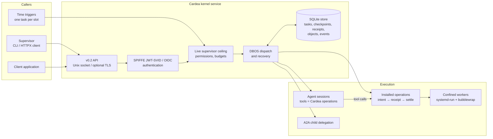

# Cardea

Cardea is a durable execution kernel for AI agents, running as a userspace service on Debian/Linux. It is for people who run agents unattended and need every action to be authenticated, bounded by a human supervisor's live authority, receipted, and recoverable after a crash.

The host OS keeps hardware, processes, networking and low-level isolation. Cardea owns the agent execution contract above it: identity, tasks, installed operations, durable state, events, budgets and recovery.



Every caller is authenticated per request; a network address or socket access grants nothing. Each operation call records a durable intent, passes a live authority check and produces a receipt. An effect interrupted mid-flight becomes `outcome_unknown` and is reconciled against the destination, never retried on assumption.

## Status

- **M0–M5 complete** for their documented bounded profiles: authenticated kernel, confined Debian host jobs, an OpenRouter/MCP agent task, A2A delegation, Debian packaging and operational recovery. See the [roadmap](roadmap.md).
- **Implemented with portable tests, not yet verified on Debian** (2026-10-15): [installed operation registry](docs/decisions/023-installed-operation-registry.md), [time triggers](docs/decisions/024-time-triggers.md), [remote TLS API](docs/decisions/025-remote-kernel-api.md), [effect idempotency and reconciliation](docs/decisions/026-effect-idempotency-and-reconciliation.md), [agent runs](docs/decisions/027-agent-runs.md), [worker profiles](docs/decisions/028-configurable-worker-profiles.md), [supervisor schedules](docs/decisions/029-supervisor-schedules-expectations-and-run-evidence.md), [small-host profile](docs/decisions/030-small-host-profile.md).
- Company adoption and general-purpose application support are unvalidated.

## Quickstart

Requires Python 3.12+ and [uv](https://docs.astral.sh/uv/).

```sh
make install
make try
```

`make try` runs the real daemon through submit, authority denial, `SIGKILL`, restart, resume and verification in a few seconds, with no SPIRE, Keycloak, VM or model key. Identity in this path is **unenforced**; see [experiments/try](experiments/try/README.md).

To see what you can run on Cardea (single operations, agent runs on Claude, OpenRouter or a local model, schedules, idempotent effects), read [Getting started](docs/getting-started.md). For an authenticated setup, follow the [M1 quickstart](docs/m1-quickstart.md). For a real host, use the [Debian package](packaging/README.md) and the [operations guide](docs/operations.md).

## Development

| Command | What it does |
|---|---|
| `make test` | All portable suites (API, load package, A2A, `try`) |
| `make lint` / `make typecheck` | Ruff and mypy, as in CI |
| `make kernel-test` | Portable record, lifecycle and retry contract tests |
| `make standards-test` | Identity, Unix-socket transport and digest fit checks |
| `make m1-demo` | Authenticated submit/crash/restart/resume demo |
| `make m1-test` | Daemon acceptance with real SPIRE and Keycloak ([setup](experiments/m1/README.md)) |
| `make kernel-openapi` | Export the v0.2 API to `packages/kernel-openapi.json` |
| `make kernel-schema` / `make kernel-demo` | Print v0.1 JSON Schemas / run the two-process persistence demo |

`make help` lists the rest, including the workflow-engine fit suites (`dbos-fit`, `temporal-fit`, `absurd-fit`, `hatchet-fit`, `spire-fit`) and the M2–M5 acceptance targets.

The code lives in `apps/api/src/cardea`: `kernel` (records, lifecycle, SQLite store), `service` (authenticated daemon, client, operations, triggers), `runtime` (model, MCP and A2A adapters) and `hosts` (Debian launcher and workers).

## Documentation

- [Getting started](docs/getting-started.md): six runnable use cases, from one operation to the same agent run on three harnesses.
- [Docs index](docs/README.md): design, kernel contract, components, decision records and product planning.
- [Design](design.md) and [kernel contract](docs/kernel-contract.md): architecture, host boundary, trust model.
- [Decision records](docs/decisions/README.md): every component choice with alternatives and evidence.
- [Coding standard](coding-standard.md) and [open-source-first policy](docs/standards-first.md).

## License and security

Licensed under the [Apache License 2.0](LICENSE). See [SECURITY.md](SECURITY.md) for the trust model and how to report vulnerabilities.
