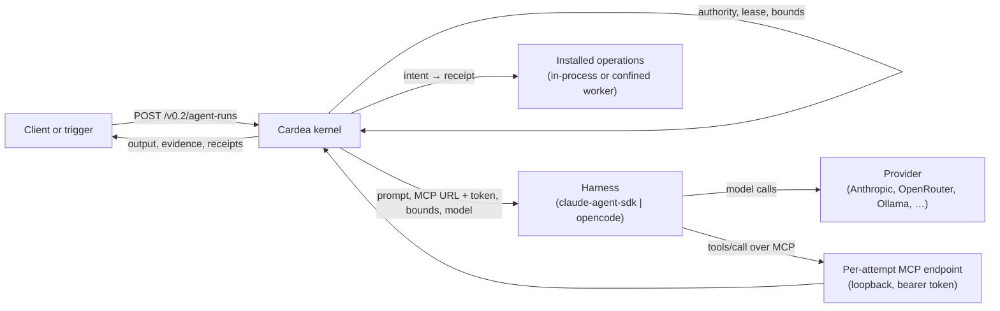
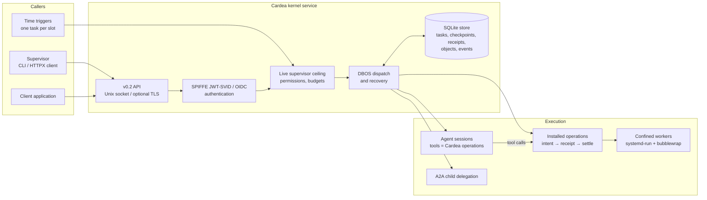

# Cardea

**Run AI agents unattended, and know exactly what they did.**

Cardea is a kernel for agent work. You hand it a task: an objective, the tools the agent may use and the limits it must stay within. Cardea runs the task under the live authority of a human supervisor and records every tool call with a receipt. It survives crashes and never repeats a side effect it can't prove didn't happen. It runs as a service on a Linux host.

## Why it exists

An agent that runs on a schedule (a daily report, a monitoring job, an inbox sweep) fails in quiet ways:

- **It does too much.** It holds credentials and tools it never needed, so one bad turn can do real damage.
- **It does things twice.** After a crash or a retry it sends the same email again.
- **It does nothing, and nobody notices.** A run that "succeeded" without sending its report looks like any other run.
- **Nobody can say what happened.** The evidence is a chat transcript, if anything.

Cardea treats each of these as a kernel concern, not something every agent has to remember:

| Problem | What Cardea does |
|---|---|
| Too much power | Tools are **installed operations**. An agent sees only the ones its task was granted, and grants never exceed its supervisor's current permissions. |
| Duplicate effects | Every call is written down as an **intent** before it runs. An effect with an idempotency scope can't happen twice, and a call cut off mid-flight is **reconciled** against the destination before anything is retried. |
| Silent no-ops | A run can declare **expectations**, for example "`messages.send` exactly once". If they aren't met, the run fails. |
| No evidence | Every call ends in a **receipt**, and the run view lists the calls, cost and turns in order. |

## What it looks like

Ask an agent to write a daily recap and send it once:

```json
POST /v0.2/agent-runs
{
  "request_id": "recap-2026-10-20",
  "agent_id": "agent-1",
  "namespace": "team",
  "objective": "Daily recap",
  "instructions": "Summarise what changed since the last recap and send it to the team channel.",
  "operations": ["listings.search", "messages.send"],
  "context": [{"operation": "notes.recent", "arguments": {"limit": 5}}],
  "expect": [{"operation": "messages.send", "min_calls": 1, "max_calls": 1}],
  "harness": "openrouter", "model": "z-ai/glm-4.6",
  "max_turns": 20, "max_cost_usd": 0.5,
  "grants": ["objects.read", "objects.write", "models.invoke", "harness:openrouter",
             "listings.search", "messages.send", "notes.recent"]
}
```

Cardea then:
1. Checks the grants against the supervisor.
2. Calls `notes.recent` and puts its output in the prompt.
3. Starts the agent with exactly two tools.
4. Stops it at 20 turns or $0.50.
5. Marks the run succeeded only if exactly one message was sent.

`GET /v0.2/tasks/{id}/run` shows what happened, call by call. Put the same request in a **trigger** with a cron schedule and it runs every morning, once per slot, even across restarts.



The agent loop itself is pluggable. A **harness** (the Claude Agent SDK, or OpenCode for OpenRouter, any OpenAI-compatible API or a local model) does the model calls. Cardea gives it nothing but a per-run MCP endpoint that serves the granted operations.

## Try it in two minutes

You need Python 3.12+ and [uv](https://docs.astral.sh/uv/).

```sh
make install
make try
```

`make try` starts the real daemon and walks it through the core cycle:
1. Submit a task.
2. See a request beyond the supervisor's authority refused.
3. `SIGKILL` the daemon mid-task.
4. Restart it and watch the task resume and finish.

It needs no identity provider, VM or model key, so identity checks are off in this mode ([details](experiments/try/README.md)).

## Where to go next

- **[Getting started](docs/getting-started.md).** Six worked use cases:
  - a single operation;
  - an agent run with context;
  - a scheduled run that must send exactly once;
  - an idempotent effect with reconciliation;
  - a confined web-research run;
  - the same run on Claude, GLM via OpenRouter and a local model.
- **[Design](design.md) and [kernel contract](docs/kernel-contract.md).** The architecture, the trust model and the host boundary.

## How it's built



- **Identity.** Every request is authenticated, with a SPIFFE JWT-SVID or an OIDC token. A network address or socket access grants nothing.
- **Authority.** A task's permissions are intersected with its supervisor's live permissions at admission, dispatch, retry and resume. Revoking the supervisor stops everything below it.
- **Durability.** Tasks run on DBOS over SQLite, so they resume after a crash.
- **Confinement.** Operations that touch the host or the web run as confined workers (`systemd-run` plus bubblewrap) behind an egress proxy.

The code is in `apps/api/src/cardea`:
- `kernel`: records, lifecycle and the store;
- `service`: the daemon, API, operations and triggers;
- `runtime`: harnesses, MCP and A2A;
- `hosts`: the Debian launcher and workers.

The API is `v0.2` and still changing. Its OpenAPI spec is at [`packages/kernel-openapi.json`](packages/kernel-openapi.json).

## Contributing

| Command | What it does |
|---|---|
| `make test` | All portable test suites |
| `make lint` / `make typecheck` | Ruff and mypy, as in CI |
| `make m1-demo` | Authenticated submit, crash, restart and resume demo |
| `make kernel-openapi` | Regenerate the OpenAPI spec |

`make help` lists the rest. Read the [coding standard](coding-standard.md) and the [open-source-first policy](docs/standards-first.md) before proposing a new component.

## License and security

Cardea is licensed under the [Apache License 2.0](LICENSE). See [SECURITY.md](SECURITY.md) for the trust model and how to report a vulnerability.
