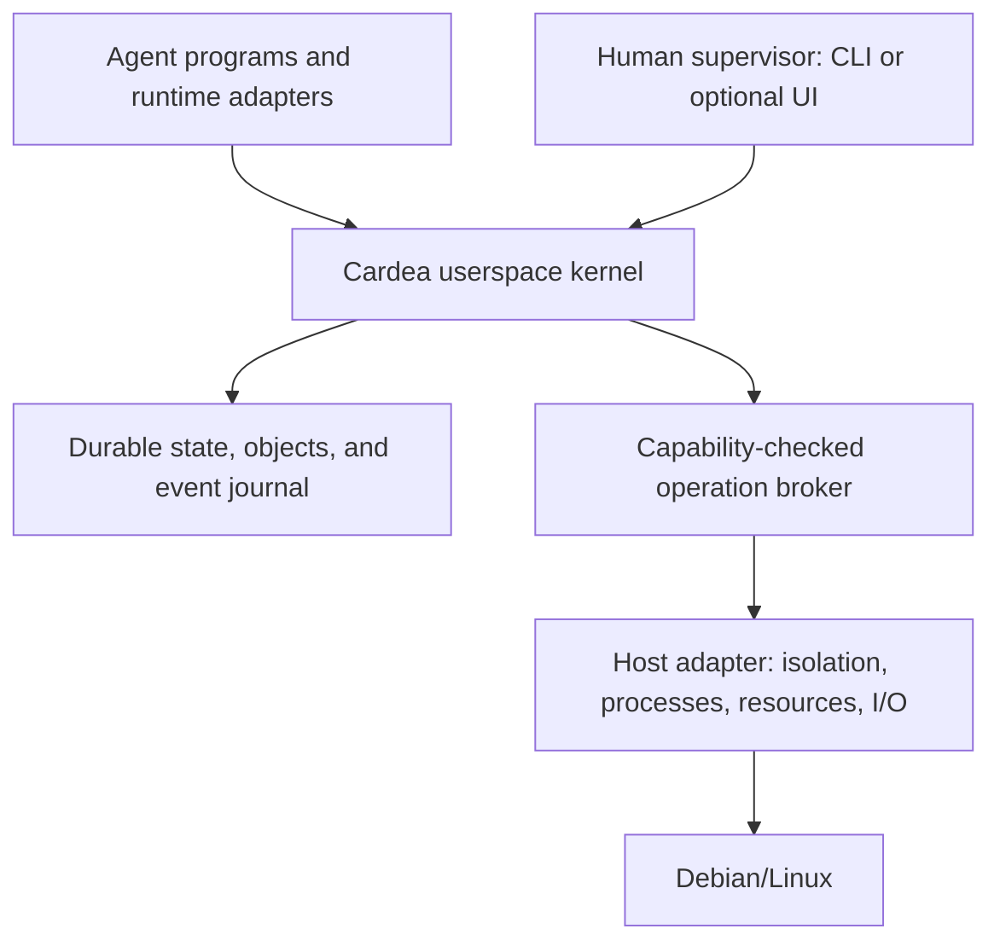

# Cardea Design

Status: versioned contracts, authenticated service, DBOS execution and the fixed M2 Debian profile are implemented and verified. M3 adds an OpenRouter broker, native MCP and a bounded incident application; deterministic and live GLM-4.7 Debian acceptance and matched load comparison pass. M4 adds native async A2A delegation, bounded child allocations and verified coordination on the same Debian host; acceptance and matched load pass. Rescoped 2026-09-21.

## Purpose

The [product direction](product.md) now targets both useful company applications and a shared operating layer across departments, sequenced in M6–M10. This expands application and company capabilities above the same agent-first kernel; it does not change the host boundary or the mandatory supervisor ceiling. M5 packaging and operational recovery are complete for the [documented Debian profile](experiments/m5/M5-REPORT.md).

Build an AI-native operating environment in which agents are the primary executing entities. Basic operations must be discoverable and usable through structured machine contracts, without a human navigating an application or translating screen state.

Cardea is a userspace operating layer hosted on Debian/Linux initially. It does not replace the host kernel, bootloader, drivers, or POSIX environment. Portability to other Unix-like systems is an architectural goal subject to host capability checks and conformance tests.

The product promise is: give an agent an objective and bounded authority; let it execute, wait, recover, and deliver an independently checked result.

## Architectural Layers

The proposed [company integration layer](docs/components/company-integration.md) connects existing systems, related records and process definitions/instances to kernel-controlled work. It is required in the first cross-team product scope. Source systems retain record authority; adapters and process applications bind their data/events/actions to generic kernel resources, tasks and evidence. The kernel must expose these integrations to agents under current permissions without embedding company-specific business rules. This remains design work under [ADR-021](docs/decisions/021-company-process-data-integration.md).

Use established open standards and maintained open-source implementations first. Build custom mechanisms only after documenting why available solutions cannot meet the required semantics or deployment constraints. This applies to every component and to earlier proposals; see [standards-first decisions](docs/standards-first.md). The [identity design](docs/components/identity-representation.md) uses SPIFFE/OpenID Connect through the provider integrations implemented and verified in [ADR-010](docs/decisions/010-m1-authenticated-kernel.md).

These are ownership and acceptance boundaries, not instructions to implement every subsystem from scratch. Integrate existing libraries/services behind them wherever they meet requirements; see the [component review](docs/standards-review-2026-09-22.md).

All arrows that cross a trust boundary require authenticated, scoped access. Applications do not get the kernel database, host credentials, or arbitrary host execution by virtue of running an agent.

### Host OS

The host provides native process scheduling, memory management, filesystems, sockets, device access, and enforcement mechanisms. A Cardea task is a durable logical process and may span many short-lived host processes and model calls.

Debian is the persistent machine on which the Cardea stack runs: kernel service, scheduler/runtime, identity services, storage, brokers and worker processes. Each job uses isolated processes on that same machine, sharing its Linux kernel; it does not boot a separate Debian installation or VM. The machine itself may be bare metal or a VM. External model/tool services remain optional integrations according to the chosen runtime.

### Cardea Kernel

Keep this trusted layer small and deterministic. It owns:

- Agent identities, capability grants, delegation limits, and revocation.
- Durable task state and lifecycle, dispatch, deadlines, cancellation, and checkpoints.
- Typed operation discovery and dispatch through a single enforcement boundary.
- Namespaced objects, versions, artifacts, and provenance.
- Durable events, subscriptions, wakeups, and task messages.
- Resource reservations, usage accounting, and admission limits.
- Operation receipts, retry classification, reconciliation, and audit history.

The kernel does not need an LLM to decide whether a capability is valid, a transition is legal, or a budget is exhausted. Reasoning belongs in agent programs. Both probabilistic and deterministic agents use the same contracts.

### Agent Runtime and Applications

A runtime adapter invokes a model or deterministic agent, provides a bounded context assembled from authorized state, validates structured requests, and submits operations to the kernel. Provider credentials remain in a trusted broker. Persist explicit task state, artifact references, messages, and operation receipts; a model context window is not the durable process state.

Applications define objectives, domain logic, and completion checks. Customer escalation, repository maintenance, and document processing are possible applications; none defines the kernel's resource model. An application must not need new kernel concepts merely to represent its business nouns.

### Human Supervisor

Humans provision identities, submit objectives, grant or revoke capabilities, inspect results, and resolve requests for additional authority. Routine operations within an existing grant run without clicks. Approval is a policy-selected escalation, not a mandatory preview/approve ritual for every operation.

The system must complete its acceptance task with the web UI stopped. Human, CLI, and agent clients use the same authorization and execution path; the UI has no hidden override.

## Agent-First Semantics

An operation describes its input and output schemas, required authority, side effects, limits, retry behavior, and completion evidence. Errors include stable codes and machine-readable recovery information.

Agents can discover only operations and resources they are allowed to discover. They can inspect work, read and write scoped objects, spawn bounded work, wait for events, and obtain receipts without parsing terminal prose. A shell is an optional restricted execution facility, not the universal API or an implicit grant to the host.

The concrete proposed contract is in [docs/kernel-contract.md](docs/kernel-contract.md).

Short designs for each component, including implementation status and acceptance checks, are in [docs/components/README.md](docs/components/README.md).

## Debian First, Portable by Contract

The initial deployment is one Debian host, one administrative trust domain, one local kernel service, SQLite metadata/journal storage, and private artifact storage. The first implementation keeps bounded object bytes in SQLite so local publication shares the journal transaction; larger artifacts will require a separate recoverable publication protocol. Use Python for the first kernel implementation to reuse the existing typed backend toolchain. FastAPI is a transport adapter, not the kernel itself. The host target and provisional runtime/session choices are recorded in [runtime decisions](docs/runtime-decisions.md); implementation selections must pass the reuse review.

Target a Debian system service with a dedicated account. The first bounded host operation uses systemd, bubblewrap and cgroup v2 behind a `HostAdapter`; see [installed host operations](docs/components/installed-host-operations.md) for its pinned profile and verified scope. These facilities confine individual workers on the persistent Debian host. Broader operations require their own acceptance checks.

The host adapter reports filesystem confinement, process-tree termination, network restrictions, CPU/memory/process limits, and supervision capabilities. Each execution profile states its required guarantees. Missing guarantees produce an explicit unsupported-profile failure, never a silent unsandboxed fallback.

macOS may remain a development host. Passing portable unit tests there does not establish Debian isolation, and supporting a Unix API does not establish equivalent sandbox guarantees on another kernel. A second host becomes supported only after its adapter passes the same relevant contract tests.

The disposable Debian VM used for acceptance from macOS represents the whole host and runs many jobs. QEMU and Docker belong to that test setup; neither is required as a per-job execution mechanism.

## Trust and Failure Model

The MVP trusts the host administrator, kernel service, approved operation implementations, and model broker. Model output, task input, worker code, and tool results cannot grant authority. Scoped workers should not access host secrets or another task's private objects.

Tasks can never have greater effective permissions than their accountable supervisor currently holds and may delegate. Persist that supervisor binding and intersect explicit task grants with current supervisor authority, every ancestor’s effective authority, and platform policy. Approval and privileged service credentials do not bypass this ceiling; supervisor revocation/disablement restricts descendants. See the [kernel contract](docs/kernel-contract.md) for enforcement and recovery requirements.

Capabilities have issuer, subject, operation/resource scope, expiry, and limits. Delegation can only reduce authority and shares the parent's budget ceiling. Revocation is checked at operation admission and dispatch; in-flight effects may require cancellation and reconciliation rather than being reversible.

Local state and journal updates commit transactionally. External effects do not become exactly-once merely because their intent is stored in SQLite. Record intent and a stable operation ID before dispatch, record receipts afterward, and represent uncertain outcomes explicitly. Retry only when the operation's deduplication or reconciliation contract makes it safe.

The audit log is append-only to applications; the MVP makes no tamper-proof guarantee against a host administrator. Data selection for model calls is subject to capabilities and disclosure policy. Store useful provenance without logging credentials or requiring hidden model reasoning.

## Scope Boundaries

Build a hosted agent OS, not a new hardware kernel or Linux distribution. Defer clustered scheduling, hostile multi-tenant hosting, arbitrary package installation, a general plugin marketplace, broad enterprise connectors, and desktop replacement.

The pre-rescope escalation UI, evaluators and fixture API are archived on the `archive/legacy-escalation-demo` branch; they are not evidence that the kernel exists.

## Technical References

These inform proposed implementation choices, not claims that those choices are implemented:

- [systemd execution environment](https://github.com/systemd/systemd/blob/main/man/systemd.exec.xml): host confinement controls to evaluate for the Debian adapter.
- [SQLite atomic commit](https://www.sqlite.org/atomiccommit.html): local transaction recovery; it does not make external effects atomic with database commits.
