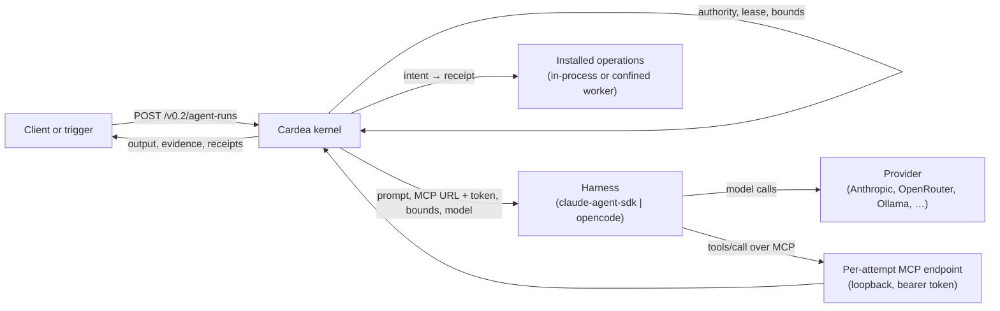

# Getting started

Cardea is a kernel for agent work. It runs tasks under explicit authority and records every tool call with an intent, a receipt and an idempotency scope. An agent run is driven by a pluggable *harness* (Claude Agent SDK, OpenCode, …) whose only tools are your installed operations, served to it over a per-attempt MCP endpoint.



Setup (install, identity, provisioning) is covered by the [M1 quickstart](m1-quickstart.md) and the [operations guide](operations.md). Operations are installed as descriptors ([ADR-023](decisions/023-installed-operation-registry.md)). Harnesses are installed in `/etc/cardea-host-harnesses.json` ([ADR-033](decisions/033-pluggable-agent-harnesses.md)).

Every request below is JSON sent to the kernel API, over its Unix socket or its TLS listener. Each carries `Authorization: Bearer <token>` and `X-Cardea-Auth: spiffe|oidc`. From Python, use `cardea.service.client.KernelClient`. From the shell, `python -m cardea.service submit-agent-run --socket … request.json`. The examples assume a supervisor with permission for the listed grants in namespace `team`, and an agent principal `agent-1`.

Every task needs `objects.read` and `objects.write`. Agent runs also need `models.invoke`, every exposed operation, and the harness grant (`harness:<id>`) when a harness registry is installed.

## 1. Run one operation

`POST /v0.2/operation-tasks`

```json
{
  "request_id": "search-1",
  "agent_id": "agent-1",
  "namespace": "team",
  "objective": "Find new listings",
  "operation": "listings.search",
  "arguments": {"query": "two bedrooms"},
  "grants": ["objects.read", "objects.write", "listings.search"]
}
```

**You get:**
- `202` with a `TaskView`: `task.state` is `queued`.
- `GET /v0.2/tasks/{task_id}/run` then shows `state: "succeeded"`, `output` (the operation's own output) and one receipted call (`operation_id: "execute"`, `calls_total: 1`).
- Retrying the same `request_id` with the same body returns the same task. Changing the body is `409 request_conflict`.

## 2. An agent run with context operations

`POST /v0.2/agent-runs`

```json
{
  "request_id": "recap-1",
  "agent_id": "agent-1",
  "namespace": "team",
  "objective": "Daily recap",
  "instructions": "Summarise what changed since the last recap and send it to the team channel.",
  "operations": ["listings.search", "messages.send"],
  "context": [{"operation": "notes.recent", "arguments": {"limit": 5}}],
  "expect": [{"operation": "messages.send", "min_calls": 1, "max_calls": 1}],
  "grants": ["objects.read", "objects.write", "models.invoke",
             "listings.search", "messages.send", "notes.recent"],
  "max_turns": 20, "max_tool_calls": 30, "max_cost_usd": 0.5
}
```

**You get:**
- Before the session, Cardea calls `notes.recent` (receipt `ctx-01`) and puts its output in the prompt as a `<context>` block ([ADR-031](decisions/031-agent-run-context-operations.md)).
- The harness sees exactly two tools, `listings-search` and `messages-send`. Each call is receipted as `call-0001`, `call-0002`, ….
- The run succeeds only if `messages.send` succeeded exactly once.
- `GET /v0.2/tasks/{id}/run` shows `output.text`, `turns`, `cost_usd`, `harness`, `model` and the calls in order. Responses stay under a size cap:
  - calls come one page at a time, with previews of their arguments and results; `calls_total` counts them all, and you pass `calls_next` as `?after=` for the next page;
  - a large output is trimmed (`output_truncated: true`), and `GET /v0.2/tasks/{id}/output` returns it whole.
- `GET /v0.2/tasks/{id}/agent-receipts` pages through the full receipts the same way.

## 3. A scheduled agent run that must send one message

`PUT /v0.2/triggers/daily-recap` (needs `tasks.schedule`)

```json
{
  "trigger_id": "daily-recap",
  "supervisor_id": "supervisor-1",
  "schedule": "30 8 * * 1-5",
  "timezone": "Europe/Paris",
  "misfire": "run_once_late",
  "template_kind": "agent-run",
  "template": {
    "agent_id": "agent-1",
    "namespace": "team",
    "objective": "Daily recap",
    "instructions": "Send today's recap to the team channel.",
    "operations": ["messages.send"],
    "expect": [{"operation": "messages.send", "min_calls": 1, "max_calls": 1}],
    "grants": ["objects.read", "objects.write", "models.invoke", "messages.send"]
  }
}
```

**You get:**
- `{"trigger_id": "daily-recap", "change": "installed"}`.
- At each slot, Cardea admits one agent run with `request_id` and `idempotency_context` set to `daily-recap.<slot>`, and `slot_time` in the trigger's timezone. If `messages.send` declares `idempotency_scope`, a retried or duplicate run for the same slot cannot send twice ([ADR-024](decisions/024-time-triggers.md), [ADR-029](decisions/029-supervisor-schedules-expectations-and-run-evidence.md)).

## 4. An effect with idempotency and reconciliation

The operation's descriptor declares which arguments identify the effect, and how to observe it afterwards:

```json
{"cardea": {"version": 1, "effect": "effect", "handler": "acme.messages.send",
            "idempotency_scope": ["/channel", "/subject"],
            "reconciler": "acme.messages.find-sent"}}
```

`POST /v0.2/operation-tasks` with `"operation": "messages.send"` and `"idempotency_context": "weekly-report.2026-W43"`.

**You get:**
- **First call:** the handler runs with `context.effect_key` (use it as the provider's idempotency key or `Message-ID`).
- **A second task in the same context with the same `/channel` and `/subject`:** a receipt marked `deduplicated` with the first output. Nothing is sent.
- **A crash mid-send:** the call becomes `outcome_unknown`, and further attempts in that scope are refused with `effect_in_doubt`.
- **Reconciliation:** `POST /v0.2/tasks/{task_id}/operations/{operation_id}/reconcile` (or the 30 s loop) calls the reconciler. It settles the call `succeeded` (it was sent) or `failed` with `effect_not_applied`, after which the scope is free again ([ADR-026](decisions/026-effect-idempotency-and-reconciliation.md)).

## 5. A confined research run

The host owner installs a read operation whose executor is a confined worker under a `public_web` profile: a memory and CPU cap, and egress only through the filtering proxy ([ADR-028](decisions/028-configurable-worker-profiles.md)):

```json
{"cardea": {"version": 1, "effect": "read",
            "executor": {"kind": "confined", "profile": "browser", "worker": "pages-fetch"},
            "timeout_seconds": 60}}
```

`POST /v0.2/agent-runs`:

```json
{
  "request_id": "research-1", "agent_id": "agent-1", "namespace": "team",
  "objective": "Background research",
  "instructions": "Read the three most relevant public pages on the topic and summarise them with links.",
  "operations": ["pages.fetch"],
  "grants": ["objects.read", "objects.write", "models.invoke", "pages.fetch"],
  "max_tool_calls": 10
}
```

**You get:** every page fetch runs in its own sandboxed process. Any of these is a failed call, and the run continues:
- a worker killed at its memory cap (`worker_exit`);
- a busy profile (`executor_busy`, retryable);
- a fetch outside public addresses (refused by the proxy).

## 6. The same run on three harnesses and models

With this registry installed (`/etc/cardea-host-harnesses.json`, root-owned):

```json
{
  "default": "claude",
  "harnesses": [
    {"id": "claude", "kind": "claude-agent-sdk",
     "package": {"name": "claude-agent-sdk", "version": "0.2.163"},
     "credential": {"file": "/etc/cardea/credentials/anthropic", "kind": "api_key"},
     "default_model": "claude-sonnet-4-5",
     "models": {"claude-sonnet-4-5": {}}},
    {"id": "openrouter", "kind": "opencode",
     "package": {"name": "opencode-ai", "version": "1.18.35",
                 "binary": "/opt/cardea/opencode/opencode", "sha256": "<from packaging/fetch_opencode.py>"},
     "provider": {"base_url": "https://openrouter.ai/api/v1"},
     "credential": {"file": "/etc/cardea/credentials/openrouter"},
     "default_model": "z-ai/glm-4.6",
     "models": {"z-ai/glm-4.6": {"price": {"input_usd_per_mtok": 0.6, "output_usd_per_mtok": 2.2}}}},
    {"id": "local", "kind": "opencode",
     "package": {"name": "opencode-ai", "version": "1.18.35",
                 "binary": "/opt/cardea/opencode/opencode", "sha256": "<same>"},
     "provider": {"base_url": "http://127.0.0.1:11434/v1"},
     "default_model": "qwen3:8b",
     "models": {"qwen3:8b": {"price": {"input_usd_per_mtok": 0, "output_usd_per_mtok": 0}}}}
  ]
}
```

The prices are examples; use your provider's. Then submit the request from use case 2 three times, changing only the selection and its grant:

| Run | Added fields | Added grant |
|---|---|---|
| Claude via Anthropic | `"harness": "claude"` | `harness:claude` |
| GLM via OpenRouter | `"harness": "openrouter", "model": "z-ai/glm-4.6"` | `harness:openrouter` |
| Local model via Ollama | `"harness": "local", "model": "qwen3:8b"` | `harness:local` |

**You get:** the same receipts, expectations and evidence for all three. Each run's `output` records its `harness`, `model`, `turns` and `cost_usd`.
- For Claude, the cost is the SDK's reported figure.
- For OpenCode, it is metered by Cardea from tokens and the registry price, and OpenCode's own estimate is kept in `usage`.
- On OpenCode, Cardea kills the harness at `max_turns` or `max_cost_usd`.

Errors:
- A harness that is not installed is `422 harness_not_installed`.
- A model it does not allow is `422 model_not_allowed`.
- A missing grant is `403 harness_not_granted`.
