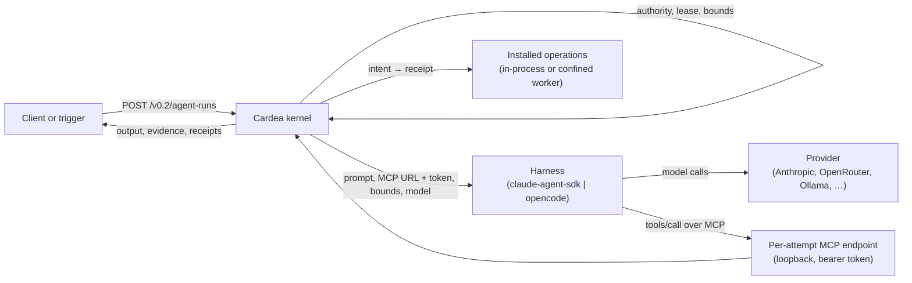

# Getting started

Cardea is a kernel for agent work. It runs tasks under explicit authority and records every tool call with an intent, a receipt and an idempotency scope. An agent run is driven by a pluggable *harness* (Claude Agent SDK, OpenCode, …) whose only tools are your installed operations, served to it over a per-attempt MCP endpoint.



Setup (install, identity, provisioning) is covered by the [M1 quickstart](m1-quickstart.md) and the [operations guide](operations.md). Operations are installed as descriptors ([ADR-023](decisions/023-installed-operation-registry.md)). Harnesses are installed in `/etc/cardea-host-harnesses.json` ([ADR-033](decisions/033-pluggable-agent-harnesses.md)).

Every request below is JSON sent to the kernel API, over its Unix socket or its TLS listener. Each carries `Authorization: Bearer <token>` and `X-Cardea-Auth: spiffe|oidc`. From Python, use `cardea.service.client.KernelClient`. From the shell, `python -m cardea.service submit-agent-run --socket … request.json`. The examples assume a supervisor with permission for the listed grants in namespace `team`, and an agent principal `agent-1`.

Every task needs `objects.read` and `objects.write`. Agent runs also need `models.invoke`, every exposed operation (except the built-in `records.*` operations, which `record:<collection>/<action>` grants authorize; see use case 8), and the harness grant (`harness:<id>`) when a harness registry is installed.

## 1. Run one operation

`POST /v0.2/operation-tasks`

```json
{
  "request_id": "search-1",
  "agent_id": "agent-1",
  "namespace": "team",
  "objective": "Find new listings",
  "operation": "listings.search",
  "arguments": {"query": "two bedrooms"},
  "grants": ["objects.read", "objects.write", "listings.search"]
}
```

**You get:**
- `202` with a `TaskView`: `task.state` is `queued`.
- `GET /v0.2/tasks/{task_id}/run` then shows `state: "succeeded"`, `output` (the operation's own output) and one receipted call (`operation_id: "execute"`, `calls_total: 1`).
- Retrying the same `request_id` with the same body returns the same task. Changing the body is `409 request_conflict`.

## 2. An agent run with context operations

`POST /v0.2/agent-runs`

```json
{
  "request_id": "recap-1",
  "agent_id": "agent-1",
  "namespace": "team",
  "objective": "Daily recap",
  "instructions": "Summarise what changed since the last recap and send it to the team channel.",
  "operations": ["listings.search", "messages.send"],
  "context": [{"operation": "notes.recent", "arguments": {"limit": 5}}],
  "expect": [{"operation": "messages.send", "min_calls": 1, "max_calls": 1}],
  "grants": ["objects.read", "objects.write", "models.invoke",
             "listings.search", "messages.send", "notes.recent"],
  "max_turns": 20, "max_tool_calls": 30, "max_cost_usd": 0.5
}
```

**You get:**
- Before the session, Cardea calls `notes.recent` (receipt `ctx-01`) and puts its output in the prompt as a `<context>` block ([ADR-031](decisions/031-agent-run-context-operations.md)).
- The harness sees exactly two tools, `listings-search` and `messages-send`. Each call is receipted as `call-0001`, `call-0002`, ….
- The run succeeds only if `messages.send` succeeded exactly once.
- `GET /v0.2/tasks/{id}/run` shows `output.text`, `turns`, `cost_usd`, `harness`, `model` and the calls in order. Responses stay under a size cap:
  - calls come one page at a time, with previews of their arguments and results; `calls_total` counts them all, and you pass `calls_next` as `?after=` for the next page;
  - a large output is trimmed (`output_truncated: true`), and `GET /v0.2/tasks/{id}/output` returns it whole.
- `GET /v0.2/tasks/{id}/agent-receipts` pages through the full receipts the same way.

## 3. A scheduled agent run that must send one message

`PUT /v0.2/triggers/daily-recap` (needs `tasks.schedule`)

```json
{
  "trigger_id": "daily-recap",
  "supervisor_id": "supervisor-1",
  "schedule": "30 8 * * 1-5",
  "timezone": "Europe/Paris",
  "misfire": "run_once_late",
  "template_kind": "agent-run",
  "template": {
    "agent_id": "agent-1",
    "namespace": "team",
    "objective": "Daily recap",
    "instructions": "Send today's recap to the team channel.",
    "operations": ["messages.send"],
    "expect": [{"operation": "messages.send", "min_calls": 1, "max_calls": 1}],
    "grants": ["objects.read", "objects.write", "models.invoke", "messages.send"]
  }
}
```

**You get:**
- `{"trigger_id": "daily-recap", "change": "installed"}`.
- At each slot, Cardea admits one agent run with `request_id` and `idempotency_context` set to `daily-recap.<slot>`, and `slot_time` in the trigger's timezone. If `messages.send` declares `idempotency_scope`, a retried or duplicate run for the same slot cannot send twice ([ADR-024](decisions/024-time-triggers.md), [ADR-029](decisions/029-supervisor-schedules-expectations-and-run-evidence.md)).

## 3b. An agent run started by a signed event

The host owner adds an event trigger to the provisioning document's `triggers` (event triggers are host-owned; `PUT /v0.2/triggers` refuses them). The secret file is private to the kernel account and holds one Standard Webhooks secret per line, such as `whsec_` followed by 32 random bytes in base64:

```json
{
  "trigger_id": "issue-triage",
  "supervisor_id": "supervisor-1",
  "event": {
    "source": "https://tracker.example.invalid/projects/demo",
    "types": ["com.example.issue.opened"],
    "filters": [{"prefix": {"subject": "issues/"}}],
    "secret_file": "/etc/cardea/event-secrets/issue-triage"
  },
  "template_kind": "agent-run",
  "template": {
    "agent_id": "agent-1",
    "namespace": "team",
    "objective": "Triage a new issue",
    "instructions": "Read the issue in the event and post a triage note to the team channel.",
    "operations": ["messages.send"],
    "expect": [{"operation": "messages.send", "min_calls": 1, "max_calls": 1}],
    "grants": ["objects.read", "objects.write", "models.invoke", "messages.send"]
  }
}
```

The sender posts a CloudEvents 1.0 event in structured JSON mode to `POST /v0.2/events/issue-triage`, with `Content-Type: application/cloudevents+json` and the Standard Webhooks headers `webhook-id`, `webhook-timestamp` and `webhook-signature` (no bearer credential):

```json
{
  "specversion": "1.0",
  "id": "evt-1001",
  "source": "https://tracker.example.invalid/projects/demo",
  "type": "com.example.issue.opened",
  "subject": "issues/42",
  "datacontenttype": "application/json",
  "data": {"title": "Login page is slow", "labels": ["performance"]}
}
```

Any Standard Webhooks library signs it. In Python, with the exact body bytes you send:

```python
from datetime import UTC, datetime
from standardwebhooks.webhooks import Webhook

signature = Webhook(secret).sign("msg-1", datetime.now(UTC), body.decode())
```

**You get:**
- `202 {"outcome": "admitted", "task_id": "task-…"}`. The run's `request_id` and `idempotency_context` are `issue-triage.e<15 hex digits>`, derived from the event's `source` and `id`. The prompt carries the event as one `<event>` block that is stated to be untrusted data ([ADR-035](decisions/035-event-triggers.md)).
- The sender retries (new `webhook-id`, same event): `202 {"outcome": "duplicate"}` with the same task, also after a restart.
- An event of another type or subject: `202 {"outcome": "ignored"}`, and nothing runs.
- A bad or stale signature is `401 invalid_signature`. A body over `event_triggers.max_event_bytes` is `413 event_too_large`. A refusal by the supervisor's live ceiling (for example `403` after `messages.send` is revoked) is recorded and leaves the event open, so a later retry can still start it.
- `GET /v0.2/triggers` lists the trigger's recent `deliveries`.

## 4. An effect with idempotency and reconciliation

The operation's descriptor declares which arguments identify the effect, and how to observe it afterwards:

```json
{"cardea": {"version": 1, "effect": "effect", "handler": "acme.messages.send",
            "idempotency_scope": ["/channel", "/subject"],
            "reconciler": "acme.messages.find-sent"}}
```

`POST /v0.2/operation-tasks` with `"operation": "messages.send"` and `"idempotency_context": "weekly-report.2026-W43"`.

**You get:**
- **First call:** the handler runs with `context.effect_key` (use it as the provider's idempotency key or `Message-ID`).
- **A second task in the same context with the same `/channel` and `/subject`:** a receipt marked `deduplicated` with the first output. Nothing is sent.
- **A crash mid-send:** the call becomes `outcome_unknown`, and further attempts in that scope are refused with `effect_in_doubt`.
- **Reconciliation:** `POST /v0.2/tasks/{task_id}/operations/{operation_id}/reconcile` (or the 30 s loop) calls the reconciler. It settles the call `succeeded` (it was sent) or `failed` with `effect_not_applied`, after which the scope is free again ([ADR-026](decisions/026-effect-idempotency-and-reconciliation.md)).

## 4b. An effect that waits for approval

Single-operation tasks only, for now ([ADR-036](decisions/036-approval-waits.md)). The descriptor says when a call needs approval in addition to authority:

```json
{"version": 1, "effect": "effect", "handler": "acme.payments.send",
 "approval": {"rules": [{"rule_id": "large-payments", "level": "conditional",
                         "when": "args.amount > 500",
                         "reason": "Payments above 500 need finance approval"}]}}
```

A host rule in the provisioning document (`"approvals": {"entries": [{"namespace", "operation", "rules"}]}`) replaces this default for one namespace. Approvers hold the Casbin `approve` mode: a permission with `"approve": true` (and `"allow": false` for an approver who may not pay), plus a matching `platform` row with `"approve": true`.

`POST /v0.2/operation-tasks` with `"operation": "payments.send"` and `"amount": 900`.

**You get:**
- **The task waits:** `GET /v0.2/tasks/{id}` shows `"state": "waiting"` and `"waiting_for": {"approval": "req-..."}`, and the journal has `approval.requested` (identifiers and digests, never arguments).
- **The approver reads the frozen intent** with `GET /v0.2/approvals/req-...` (or lists `GET /v0.2/approvals?namespace=finance`) and decides, echoing its `intent_digest`:

```json
{"decision_id": "finance-1042", "decision": "approve",
 "intent_digest": "<intent_digest from the request>", "reason": "Invoice checked"}
```

- **Approve:** the stored arguments run once as operation `apr-01`; the receipt's `arguments.context.approval` names the approver, decision, time and argument hash.
- **Reject:** the task fails with `approval_rejected`. If the approver, the supervisor's ceiling or the operation version changed first, the request becomes `void` and the task fails with `approval_void`. Nothing runs in either case.
- **Retrying** the same `decision_id` returns the recorded decision; a second approver gets `409 approval_closed` with the current `state`. The requesting agent and the kernel runtime get `403 self_approval`.

## 5. A confined research run

The host owner installs a read operation whose executor is a confined worker under a `public_web` profile: a memory and CPU cap, and egress only through the filtering proxy ([ADR-028](decisions/028-configurable-worker-profiles.md)):

```json
{"cardea": {"version": 1, "effect": "read",
            "executor": {"kind": "confined", "profile": "browser", "worker": "pages-fetch"},
            "timeout_seconds": 60}}
```

`POST /v0.2/agent-runs`:

```json
{
  "request_id": "research-1", "agent_id": "agent-1", "namespace": "team",
  "objective": "Background research",
  "instructions": "Read the three most relevant public pages on the topic and summarise them with links.",
  "operations": ["pages.fetch"],
  "grants": ["objects.read", "objects.write", "models.invoke", "pages.fetch"],
  "max_tool_calls": 10
}
```

**You get:** every page fetch runs in its own sandboxed process. Any of these is a failed call, and the run continues:
- a worker killed at its memory cap (`worker_exit`);
- a busy profile (`executor_busy`, retryable);
- a fetch outside public addresses (refused by the proxy).

## 6. The same run on three harnesses and models

With this registry installed (`/etc/cardea-host-harnesses.json`, root-owned):

```json
{
  "default": "claude",
  "harnesses": [
    {"id": "claude", "kind": "claude-agent-sdk",
     "package": {"name": "claude-agent-sdk", "version": "0.2.163"},
     "credential": {"file": "/etc/cardea/credentials/anthropic", "kind": "api_key"},
     "default_model": "claude-sonnet-4-5",
     "models": {"claude-sonnet-4-5": {}}},
    {"id": "openrouter", "kind": "opencode",
     "package": {"name": "opencode-ai", "version": "1.18.35",
                 "binary": "/opt/cardea/opencode/opencode", "sha256": "<from packaging/fetch_opencode.py>"},
     "provider": {"base_url": "https://openrouter.ai/api/v1"},
     "credential": {"file": "/etc/cardea/credentials/openrouter"},
     "default_model": "z-ai/glm-4.6",
     "models": {"z-ai/glm-4.6": {"price": {"input_usd_per_mtok": 0.6, "output_usd_per_mtok": 2.2}}}},
    {"id": "local", "kind": "opencode",
     "package": {"name": "opencode-ai", "version": "1.18.35",
                 "binary": "/opt/cardea/opencode/opencode", "sha256": "<same>"},
     "provider": {"base_url": "http://127.0.0.1:11434/v1"},
     "default_model": "qwen3:8b",
     "models": {"qwen3:8b": {"price": {"input_usd_per_mtok": 0, "output_usd_per_mtok": 0}}}}
  ]
}
```

The prices are examples; use your provider's. Then submit the request from use case 2 three times, changing only the selection and its grant:

| Run | Added fields | Added grant |
|---|---|---|
| Claude via Anthropic | `"harness": "claude"` | `harness:claude` |
| GLM via OpenRouter | `"harness": "openrouter", "model": "z-ai/glm-4.6"` | `harness:openrouter` |
| Local model via Ollama | `"harness": "local", "model": "qwen3:8b"` | `harness:local` |

**You get:** the same receipts, expectations and evidence for all three. Each run's `output` records its `harness`, `model`, `turns` and `cost_usd`.
- For Claude, the cost is the SDK's reported figure.
- For OpenCode, it is metered by Cardea from tokens and the registry price, and OpenCode's own estimate is kept in `usage`.
- On OpenCode, Cardea kills the harness at `max_turns` or `max_cost_usd`.

Errors:
- A harness that is not installed is `422 harness_not_installed`.
- A model it does not allow is `422 model_not_allowed`.
- A missing grant is `403 harness_not_granted`.

## 7. A group of agents from one manifest

An agent group ([ADR-034](decisions/034-agent-groups-and-shared-records.md), slice 4) is a set of agent principals that a supervisor declares in one document. Each pool's members share delegated grants, a run template and time triggers. The supervisor needs `groups.manage` in the namespace, and it must be able to delegate every pool grant. Send the manifest with `PUT /v0.2/groups/desk`, and add `?dry_run=true` to see the plan without changing anything:

```json
{
  "apiVersion": "cardea/v1alpha1",
  "kind": "AgentGroup",
  "metadata": {"name": "desk", "namespace": "team"},
  "spec": {
    "supervisor": "sup-1",
    "pools": [
      {"name": "analyst", "replicas": 2,
       "grants": ["objects.read", "objects.write", "models.invoke", "listings.search"],
       "run": {"instructions": "Review new listings and record what changed.",
               "operations": ["listings.search"],
               "bounds": {"max_cost_usd": 0.5, "attempts": 2, "timeout_seconds": 600}},
       "triggers": [{"schedule": {"cron": "0 9 * * 1-5", "timezone": "UTC", "misfire": "skip"}}]}
    ]
  }
}
```

A pool's `grants` are its runs' complete grants, and nothing is added. An agent run needs `objects.read`, `objects.write`, `models.invoke` and a grant for every exposed or context operation (for `records.*`, the record grants of use case 8).

**You get:** two principals, `desk.analyst.0` and `desk.analyst.1`. They are bound to the kernel's runtime and have no external identity. Each has one trigger, `desk.analyst.<n>.t0`. Every slot runs full admission under the supervisor's live ceiling. A member runs one task at a time: a slot that arrives while its previous run is unfinished is recorded as `coalesced`. `GET /v0.2/groups/desk?namespace=team` returns the manifest with `status.members`.

To restructure the group, change the manifest and apply it again. For example, set `replicas` to 3 or pick another `model`; no code change is needed. Until ADR-034 slice 8 lands, scaling down, removing a pool and deleting the group are refused with `409 group_drain_unsupported`. Until their slices land, `spend`, `expect_window` and `event` triggers are refused with 422.

## 8. A shared collection of records

A supervisor holding `groups.manage` in the namespace defines a collection ([ADR-034](decisions/034-agent-groups-and-shared-records.md), slice 1). `PUT /v0.2/collections/work` (add `?dry_run=true` to see the plan without applying it):

```json
{
  "apiVersion": "cardea/v1alpha1",
  "kind": "Collection",
  "metadata": {"name": "work", "namespace": "team"},
  "spec": {
    "supervisor": "supervisor-1",
    "schema": {"type": "object", "required": ["title"],
               "properties": {"title": {"type": "string"}, "body": {"type": "string"}}},
    "max_record_bytes": 16384,
    "guards": {"update": "record.created_by == caller.id"},
    "claims": {"lease_seconds": 14400, "max_per_holder": 1, "max_followups": 6,
               "standalone": true}
  }
}
```

Agents then use the built-in operations `records.create`, `records.get`, `records.query` and `records.update`, as tools of an agent run or as operation tasks. Each call needs the grant `record:<collection>/<action>` (`create`, `read` or `update`); the operation name itself is not a grant. `POST /v0.2/operation-tasks`:

```json
{
  "request_id": "file-1",
  "agent_id": "agent-1",
  "namespace": "team",
  "objective": "File one work item",
  "operation": "records.create",
  "arguments": {"collection": "work", "client_key": "triage-2026-11-09-1",
                "data": {"title": "Flaky login test"}, "labels": ["triage"]},
  "grants": ["objects.read", "objects.write", "record:work/create"]
}
```

and later, from version 1 of the record:

```json
{
  "request_id": "edit-1",
  "agent_id": "agent-1",
  "namespace": "team",
  "objective": "Add detail to the item",
  "operation": "records.update",
  "arguments": {"collection": "work", "record_id": "rec-00000000000000000000000000000001",
                "expected_version": 1, "data": {"title": "Flaky login test", "body": "Fails 1 in 20"}},
  "grants": ["objects.read", "objects.write", "record:work/update"]
}
```

**You get:**
- `PUT` returns the document with `metadata.generation`, `status.observedGeneration` and `plan.change` (`created`, `updated` or `unchanged`).
- `records.create` outputs `{"record": {...}}` with `record_id`, `version: 1` and `created_by: "agent-1"`. Repeating it in the same idempotency context with the same `client_key` returns the same record (`deduplicated`).
- `records.update` with a stale `expected_version` fails with `version_conflict`. Data that does not match the schema fails with `record_invalid`, and a guard that is false or cannot be evaluated fails with `guard_refused`. A call without the record grant fails with `task_grant_denied`, or `authority_denied` once the supervisor's own grant is revoked.
- `GET /v0.2/collections/work/records/{record_id}/events?namespace=team` lists the record's append-only history: actor, task, receipt, old and new values.

**Claims** ([ADR-034](decisions/034-agent-groups-and-shared-records.md) slice 2). With `claims` set, an agent holding `record:work/claim` takes a record with `records.claim {"collection": "work", "record_id": …}`:
- Exactly one of several concurrent claims wins; the others get `record_claimed`. A holder may hold `max_per_holder` records (`claim_limit` beyond that).
- The output's `claim` carries `claim_epoch`, `lease_expires_at` and `idempotency_context` (`<record_id>.<epoch>`). Use that context for effects taken for the record, so a later holder of the same record cannot repeat them.
- The claim belongs to the agent principal, not to one run. Each attempt of its runs keeps the lease past that attempt, a successful run renews it to the full `lease_seconds`, and claiming again renews it. Failed runs renew nothing.
- Pass `claim_epoch` to `records.update` to write only while you still hold the record, and to `records.release` to give it back. A stale holder gets `claim_lost`.
- When the lease runs out, the next minute tick releases the record with a new epoch. A group member that holds a record but has no run in progress gets a follow-up run from its first trigger once less than half the lease is left, at most `max_followups` per epoch.
- `records.claimed {"collection": "work"}` lists the caller's live claims; it also works as a context operation.
